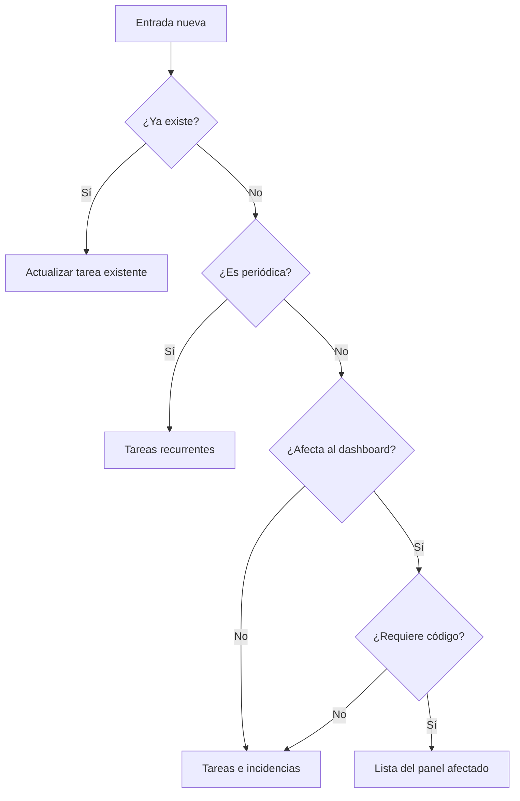

# Guía operativa de gestión en ClickUp — Elaborados Naturales

> Documento maestro para registrar, clasificar, ejecutar y cerrar correctamente tareas, incidencias, mejoras del dashboard, pruebas, PR, releases y trabajos recurrentes.

## 1. Objetivo

Esta guía debe utilizarse siempre que una persona o una IA cree, modifique o complete trabajo en ClickUp dentro del espacio **Elaborados Naturales**.

Sus objetivos son:

- Evitar tareas duplicadas o creadas en lugares incorrectos.
- Saber qué está pendiente, en desarrollo, en validación, publicado o bloqueado.
- Mantener trazabilidad desde la idea o incidencia hasta su cierre real.
- Relacionar los cambios del dashboard con GitHub, pruebas, releases e instalación en producción.
- Diferenciar duración planificada, tiempo real registrado y fechas reconstruidas históricamente.
- Mantener ClickUp claro y útil tanto para el trabajo diario como para el histórico del proyecto.

---

## 2. Estructura oficial de ClickUp

```text
Espacio: Elaborados Naturales
├── Carpeta: ENR Analytics                    (SOLO código de este dashboard)
│   ├── Lista: Producción
│   ├── Lista: Pedidos
│   ├── Lista: Caducados
│   ├── Lista: Comparativa SERES
│   ├── Lista: Stock PDA
│   ├── Lista: Compras
│   ├── Lista: Loteadora
│   ├── Lista: Plataforma y administración
│   └── Lista: Releases
│
├── Carpeta: Operativa diaria
│   ├── Lista: Tareas e incidencias
│   └── Lista: Tareas recurrentes
│
├── Carpeta: JDE - Evolutivos e Instalaciones
│   ├── Lista: Evolutivos
│   └── Lista: Instalaciones
│
└── Carpeta: Documentación
    ├── Lista: Documentación JDE
    ├── Lista: Documentación ENR Analytics
    ├── Lista: Documentación Reflex
    └── Lista: Documentación General
```

**Regla estricta:** dentro de la carpeta `ENR Analytics` no debe existir ninguna lista `Documentación` ni `JDE - Evolutivos e Instalaciones` — esas viven exclusivamente en sus propias carpetas de nivel superior. Tampoco debe haber listas `Documentación` sueltas directamente en el espacio, fuera de cualquier carpeta. Si aparecen, es un error de estructura: no crear tareas ahí, avisar y mover/eliminar la lista duplicada (ver `MANUAL_IA_ALIMENTAR_CLICKUP.md` §0).

### Principio de organización

- **Espacio:** empresa o entorno general.
- **Carpeta:** producto, aplicación o tipo de trabajo.
- **Lista:** panel o área funcional estable.
- **Tarea:** resultado concreto que debe conseguirse.
- **Subtarea:** paso independiente que necesita responsable, fechas o seguimiento propio.
- **Checklist:** pasos pequeños que no necesitan seguimiento independiente.
- **Comentario:** novedad relevante ocurrida después de crear la tarea.
- **Release:** publicación conjunta que puede incluir cambios de varios paneles.

Las listas representan áreas, no estados. Una tarea no se mueve entre listas solamente porque avance de pendiente a desarrollo o revisión; para eso se utilizan los estados.

---

## 3. Regla principal al recibir una nueva entrada

Antes de crear nada, responder internamente a estas preguntas:

1. ¿Ya existe una tarea que representa el mismo resultado o problema?
2. ¿Es una incidencia, una tarea operativa, una mejora del dashboard o un trabajo recurrente?
3. ¿Afecta a un panel concreto de ENR Analytics?
4. ¿Requiere modificar código?
5. ¿Tiene una fecha límite real?
6. ¿Es necesario realizar pruebas, revisión, release o instalación en producción?

### Decisión rápida



### Nunca hacer

- Crear una tarea nueva sin buscar antes posibles duplicados.
- Crear listas por días, semanas o estados.
- Crear una tarea llamada únicamente `Error`, `Revisar`, `Prueba` o `Pendiente`.
- Marcar como completado algo que todavía necesita validación, release o comprobación en producción.
- Crear una release para un cambio que solo está en `develop`.
- Duplicar una incidencia en Operativa diaria y ENR Analytics; debe moverse o mantenerse una única tarea trazable.

---

## 4. Clasificación de las entradas

### 4.1 Tarea operativa diaria

Trabajo puntual que no modifica el dashboard:

- Consulta en JDE.
- Revisión de datos.
- Preparación de un informe.
- Llamada o seguimiento.
- Configuración de usuarios.
- Gestión administrativa.

**Ubicación:** `Operativa diaria > Tareas e incidencias`.

**Formato del nombre:**

```text
[TAREA][Área] Resultado esperado
```

Ejemplo:

```text
[TAREA][JDE] Revisar permisos de escritura del usuario de almacén
```

### 4.2 Incidencia

Comportamiento incorrecto, interrupción, error o resultado inesperado.

**Ubicación inicial:** `Operativa diaria > Tareas e incidencias`.

**Formato del nombre:**

```text
[INC][Sistema o panel] Problema observable
```

Ejemplos:

```text
[INC][Loteadora] P_Status=12 al enviar el campo remoto 1D
[INC][Producción] La exportación Excel omite artículos filtrados
```

Si durante el análisis se confirma que requiere modificar código de ENR Analytics, mover la misma tarea a la lista del panel afectado. No crear una copia.

### 4.3 Mejora o funcionalidad del dashboard

Cambio que añade, modifica o elimina comportamiento del dashboard.

**Ubicación:** lista del panel afectado dentro de `ENR Analytics`.

**Formato del nombre:**

```text
[Panel] Verbo + resultado funcional
```

Ejemplos:

```text
[Producción] Añadir filtro por Gramaje
[Compras] Comparar previsión mensual con venta real
[Comparativa] Mostrar incidencias según estado JDE
```

Si afecta transversalmente a varios paneles, utilizar `Plataforma y administración`.

### 4.4 Tarea recurrente

Trabajo que debe repetirse con una frecuencia conocida.

**Ubicación:** `Operativa diaria > Tareas recurrentes`.

Ejemplos:

```text
[RECURRENTE][Semanal] Revisar errores registrados por el dashboard
[RECURRENTE][Mensual] Validar copias de seguridad de la base de datos
```

Configurar recurrencia solamente cuando se conozca la periodicidad real. Cada repetición debe poder completarse de forma independiente.

### 4.5 Seguimiento

Acción que depende de una persona, proveedor, usuario o validación externa.

```text
[SEGUIMIENTO][Compras] Confirmar las cifras con el director del área
```

Puede permanecer en `Tareas e incidencias` o ser una subtarea de la funcionalidad relacionada si su resolución condiciona directamente el cierre.

---

## 5. Estados oficiales y significado

| Estado | Cuándo utilizarlo | Qué debe ocurrir después |
|---|---|---|
| `pending` | Entrada registrada y todavía no iniciada | Analizar, priorizar y decidir fecha |
| `in progress` | Existe trabajo activo real | Desarrollar, investigar o ejecutar |
| `in review` | El PR está **al menos fusionado en `develop`**, pero falta validar, publicar en `main` o confirmar | Probar, revisar, publicar o validar |
| `completed` | Resultado validado y sin acciones pendientes | Conservar como histórico |
| `closed` | Solo para archivo excepcional | Evitarlo en el trabajo normal porque puede ocultarse del Gantt |

Una tarea con rama abierta y PR aún sin fusionar (aunque exista PR en borrador) permanece en `in progress`, nunca en `in review`.

### Trabajo bloqueado

Si no existe un estado específico `blocked`, mantener el estado operativo correspondiente y añadir al comienzo de la descripción:

```text
⛔ BLOQUEADA
Motivo: pendiente de acceso al servidor de producción.
Responsable del desbloqueo: Nombre o área.
Próxima revisión: DD/MM/AAAA.
```

Añadir además un comentario cuando aparezca el bloqueo y otro cuando se desbloquee.

---

## 6. Fechas y medición del tiempo

### 6.1 Fechas que deben distinguirse

- **Fecha de creación:** cuando se registra la idea, petición o incidencia.
- **Fecha de inicio:** cuando comienza realmente el análisis o trabajo activo.
- **Fecha límite:** compromiso o previsión de finalización.
- **Fecha de finalización:** cuando se valida el resultado.
- **Fecha de release:** cuando el código llega a `main` o se genera la versión.
- **Fecha de producción:** cuando la versión queda instalada y comprobada.

La fecha en la que se pensó una idea no debe utilizarse como inicio de desarrollo. Se conserva como fecha de creación o se documenta en la descripción.

### 6.2 Trabajo futuro

- Crear la tarea cuando aparezca la idea.
- Mantenerla en `pending` sin fecha de inicio si todavía no se ha comenzado.
- Asignar inicio cuando pase realmente a `in progress`.
- Registrar tiempo con el contador de ClickUp cuando sea posible.
- Corregir la fecha límite si cambia la planificación, explicándolo en un comentario si el cambio es relevante.

### 6.3 Reconstrucción histórica

Cuando se reconstruya trabajo pasado desde Git:

- El final debe apoyarse en el commit o PR.
- El inicio puede estimarse según primer commit, complejidad, archivos modificados y continuidad con la tarea anterior.
- La descripción debe indicar expresamente que el inicio es estimado.
- No presentar la estimación como horas reales trabajadas.

Texto obligatorio:

```text
Las fechas iniciales y las horas son una reconstrucción orientativa para el Gantt; no representan tiempo histórico registrado.
```

El bloque de reconstrucción histórica es un estado provisional, no definitivo. Si sobre esa tarea vuelve a haber trabajo real (nueva rama, nuevo PR, nueva petición del usuario), sustituir el bloque por la plantilla normal de la sección 8 y registrar desde ese momento fechas e información reales — no dejar conviviendo indefinidamente una tarea "reconstruida" que en realidad sigue viva.

---

## 7. Prioridad y orden diario

| Prioridad | Criterio | Objetivo de atención |
|---|---|---|
| Urgente | Producción detenida, riesgo de datos o seguridad | Inmediato |
| Alta | Bloquea a varias personas o un proceso importante | Durante el día |
| Normal | Existe alternativa temporal o no hay bloqueo grave | Planificar |
| Baja | Mejora, limpieza o trabajo sin impacto inmediato | Backlog |

### Límite de trabajo activo

- Máximo una tarea principal `in progress`.
- Se admite una incidencia urgente adicional.
- El resto permanece `pending`, `in review` o bloqueado.
- No iniciar trabajo nuevo para evitar cerrar o validar el anterior, salvo urgencia real.

---

## 8. Contenido obligatorio de una tarea

Toda tarea debe permitir entender qué ocurre sin consultar conversaciones externas.

### Plantilla general

```markdown
## Origen

- Quién lo pide: persona, planta/área o "idea propia".
- Canal: verbal en planta / Teams / correo / reunión / incidencia observada.
- Fecha de la petición:

## Objetivo

Resultado concreto que debe conseguirse.

## Contexto

Por qué se necesita, quién lo solicita y qué proceso afecta.

## Alcance

- Incluye:
- No incluye:

## Criterios de aceptación

- [ ] Condición observable 1.
- [ ] Condición observable 2.
- [ ] El usuario o responsable confirma el resultado.

## Evidencias

- Captura, error, consulta, documento o enlace relacionado.

## Fechas

- Idea o petición recibida:
- Inicio real:
- Fecha objetivo:

## Resultado final

Completar al cerrar la tarea.
```

El bloque **Origen** es lo que permite reconstruir, meses después, que una tarea nació de una petición real de planta y no de una decisión interna. Si el origen es una idea propia sin solicitante externo, indicarlo explícitamente en vez de dejarlo vacío.

### Plantilla de incidencia

```markdown
## Origen

- Quién lo reporta: persona, planta/área.
- Canal: verbal en planta / Teams / correo / reunión.
- Fecha del reporte:

## Problema observado

Descripción objetiva del error.

## Impacto

Usuarios, proceso y urgencia.

## Cómo reproducirlo

1. Paso 1.
2. Paso 2.
3. Resultado incorrecto.

## Resultado esperado

Comportamiento correcto.

## Evidencias

- Mensaje de error:
- Capturas:
- Fecha y hora:
- Usuario, planta, lote u orden afectados:

## Diagnóstico

Completar durante la investigación.

## Solución

Completar cuando se aplique.

## Validación

- [ ] Reproducido antes de corregir.
- [ ] Solución probada.
- [ ] Validación del usuario o en entorno real.
- [ ] Producción comprobada si aplica.
```

### Plantilla de funcionalidad del dashboard

```markdown
## Origen

- Quién lo pide: persona, planta/área o "idea propia".
- Canal: verbal en planta / Teams / correo / reunión.
- Fecha de la petición:

## Necesidad

Problema o mejora solicitada.

## Resultado funcional

Qué podrá hacer el usuario cuando termine.

## Alcance

- Panel:
- Usuarios afectados:
- Datos o sistemas implicados:
- Fuera de alcance:

## Criterios de aceptación

- [ ] Funcionalidad implementada.
- [ ] Datos comprobados.
- [ ] Estados vacío, carga y error considerados.
- [ ] Permisos y logs revisados si aplica.
- [ ] Documentación actualizada si aplica.

## Trazabilidad técnica

- Rama:
- PR:
- Merge en `develop`:
- Release o PR a `main`:
- Instalación en producción:

## Pruebas

- Build:
- Tests automáticos:
- Prueba manual:
- Validación del usuario:

## Resultado final

Resumen de lo entregado y cualquier limitación conocida.
```

---

## 9. Flujo de una funcionalidad del dashboard

### 9.1 Idea o petición

1. Buscar duplicados.
2. Crear la tarea en la lista del panel.
3. Estado `pending`.
4. Registrar contexto, resultado y criterios de aceptación.
5. No asignar inicio hasta comenzar el trabajo.

### 9.2 Análisis y planificación

1. Aclarar alcance.
2. Identificar datos, permisos, riesgos y dependencias.
3. Añadir estimación y fecha objetivo.
4. Dividir en subtareas solo si existen entregables independientes.

### 9.3 Desarrollo

1. Pasar a `in progress`.
2. Establecer fecha de inicio real.
3. Crear rama relacionada con la tarea.
4. Realizar commits claros.
5. Añadir comentarios solo ante decisiones, bloqueos o cambios relevantes.

Convención recomendada para ramas:

```text
feature/panel-descripcion-corta
fix/panel-descripcion-error
chore/descripcion-mantenimiento
```

Convención recomendada para commits:

```text
feat(produccion): añadir filtro de gramaje
fix(loteadora): interpretar correctamente P_Status 12
docs(compras): documentar cálculo de venta real
```

### 9.4 Pruebas

No crear una tarea independiente de prueba si solamente es un paso normal de la misma funcionalidad. Utilizar checklist o subtarea.

Crear una subtarea de prueba cuando:

- Requiera una máquina física.
- Dependa de otra persona o área.
- Tenga fecha propia.
- Pueda bloquear el release.
- Necesite varias sesiones o evidencias independientes.

Ejemplo correcto:

```text
Tarea: [Loteadora] Enviar lote y caducidad mediante protocolo TIJ
└── Subtarea: Validar el envío TCP en la loteadora física
```

No deben existir dos tareas duplicadas llamadas `Enviar por TCP` y `Probar envío TCP` si ambas representan el mismo resultado final.

### 9.5 Pull request y merge a develop

1. Añadir el enlace del PR a la tarea.
2. Resumir cambios y pruebas realizadas.
3. Si el PR se fusiona únicamente en `develop`, pasar a `in review`.
4. No marcar como `completed` ni crear release todavía.

### 9.6 Release y producción

Las releases se registran en `ENR Analytics > Releases` porque pueden incluir varios paneles.

Formato:

```text
[RELEASE] vX.Y.Z — AAAA-MM-DD
```

Descripción mínima:

```markdown
## Contenido

- Tarea y panel incluidos.

## Git

- PR a main:
- Tag o versión:
- Commit:

## Instalación

- Fecha:
- Entorno:
- Responsable:

## Validación posterior

- [ ] Aplicación accesible.
- [ ] Funcionalidades principales comprobadas.
- [ ] Sin errores críticos nuevos.
```

Después de instalar:

1. Comentar en cada tarea incluida que se ha publicado.
2. Añadir enlace a la release.
3. Comprobar el resultado en producción.
4. Marcar `completed` solamente tras la validación.

---

## 10. Cuándo escribir comentarios

Los comentarios deben contar la evolución de la tarea sin repetir información automática de ClickUp.

### Comentar cuando

- Se descubre la causa de una incidencia.
- Aparece o desaparece un bloqueo.
- Cambia significativamente el alcance.
- Cambia una fecha comprometida y es necesario explicar por qué.
- Se toma una decisión técnica o funcional importante.
- Se abre un PR.
- Se termina una prueba relevante.
- Se realiza un merge, release o instalación.
- Un usuario valida o rechaza el resultado.
- Se cierra con una solución que conviene conservar.

### No comentar cuando

- Solo se cambia el responsable, prioridad o estado y ClickUp ya lo registra.
- Se realiza un commit pequeño sin impacto independiente.
- El comentario repite literalmente la descripción.
- No existe ninguna novedad útil para otra persona o para el histórico.

### Formato de comentario de progreso

```markdown
**Progreso — DD/MM/AAAA**

- Realizado:
- Resultado:
- Pendiente:
- Bloqueo o riesgo:
- Próximo paso:
```

### Comentario de bloqueo

```markdown
**Bloqueada — DD/MM/AAAA**

- Motivo:
- Dependencia o persona:
- Acción realizada:
- Próxima revisión:
```

### Comentario de PR

```markdown
**PR abierto**

- Enlace:
- Rama:
- Cambios principales:
- Pruebas realizadas:
- Pendiente antes del merge:
```

### Comentario de publicación

```markdown
**Publicado en producción — DD/MM/AAAA**

- Release:
- Commit o PR:
- Validación realizada:
- Resultado:
- Limitaciones conocidas:
```

---

## 11. Definición de terminado

### Tarea operativa

- Resultado ejecutado.
- Evidencia o respuesta registrada.
- Persona solicitante informada cuando corresponda.
- Sin seguimientos pendientes.

### Incidencia sin código

- Causa identificada cuando sea posible.
- Solución aplicada.
- Usuario o proceso validado.
- Resultado final documentado.

### Incidencia o funcionalidad con código

- Criterios de aceptación cumplidos.
- Build correcto.
- Tests relevantes correctos.
- Prueba manual realizada.
- PR fusionado.
- Documentación actualizada cuando sea necesario.
- Release registrado.
- Instalación en producción realizada.
- Producción validada.
- Comentario final añadido.

Si falta cualquiera de los tres últimos pasos, normalmente debe permanecer `in review`, no `completed`.

---

## 12. Rutina de trabajo diario

### Inicio del día

1. Revisar `Tareas e incidencias`.
2. Clasificar entradas nuevas.
3. Revisar tareas bloqueadas o en validación.
4. Elegir una tarea principal.
5. Pasarla a `in progress` y registrar inicio.

### Durante el día

1. Registrar incidencias inmediatamente.
2. No abandonar la tarea principal salvo urgencia real.
3. Añadir comentarios ante decisiones o bloqueos.
4. Registrar tiempo cuando sea posible.

### Final del día

1. Actualizar el estado real de cada tarea tocada.
2. Añadir un comentario si existe progreso relevante.
3. Dejar escrito el próximo paso.
4. Revisar fechas vencidas.
5. Elegir la primera tarea del día siguiente.

---

## 13. Instrucciones para una IA que gestione ClickUp

Cuando el usuario proporcione una idea, tarea, petición, incidencia o avance, la IA debe seguir este procedimiento:

1. Interpretar el resultado que el usuario necesita.
2. Buscar tareas existentes relacionadas por nombre, descripción y panel.
3. Si existe una tarea equivalente, actualizarla; no crear otra.
4. Clasificar la entrada según la sección 4.
5. Elegir la lista correcta.
6. Crear un nombre específico conforme a las convenciones.
7. Completar una descripción autosuficiente.
8. Asignar prioridad según impacto real.
9. Registrar la fecha de creación.
10. No inventar una fecha de inicio para trabajo futuro no iniciado.
11. Si se trata de trabajo histórico, indicar explícitamente qué fechas son estimadas y aportar evidencia.
12. Utilizar `pending`, `in progress`, `in review` o `completed` según el resultado real.
13. Añadir comentarios únicamente cuando exista una novedad relevante.
14. Si aparece un PR, enlazarlo y registrar pruebas.
15. Si está solo en `develop`, mantener `in review`.
16. Crear o actualizar una tarea de release únicamente cuando exista publicación real a `main`.
17. Completar la tarea después de validar producción.
18. Informar al usuario de qué se ha creado o actualizado, dónde se ha ubicado, estado, fechas y próximos pasos.

### Respuesta mínima después de actuar

```markdown
- Acción: creada / actualizada / movida.
- Tarea:
- Ubicación:
- Estado:
- Prioridad:
- Inicio y fecha objetivo:
- Evidencia añadida:
- Próximo paso:
```

### Si faltan datos

La IA debe completar lo razonablemente inferible sin inventar hechos. Solo debe preguntar cuando la respuesta cambie materialmente la ubicación, prioridad, responsable, fecha o criterio de finalización.

---

## 14. Ejemplos completos

### Ejemplo A: idea futura del panel Producción

Petición:

```text
Quiero poder filtrar Producción por turno.
```

Acción:

- Buscar si ya existe.
- Crear en `ENR Analytics > Producción`.
- Nombre: `[Producción] Añadir filtro por turno`.
- Estado: `pending`.
- Fecha de inicio: vacía hasta comenzar.
- Criterios de aceptación: filtro visible, resultados correctos, exportación coherente y presets compatibles.

### Ejemplo B: incidencia de Loteadora

Petición:

```text
La máquina devuelve P_Status=12 cuando envío el lote.
```

Acción:

- Crear inicialmente en `Operativa diaria > Tareas e incidencias`.
- Nombre: `[INC][Loteadora] P_Status=12 al enviar lote por TCP`.
- Prioridad según si bloquea producción.
- Documentar plantilla cargada, estado de impresión, comando y respuesta.
- Si exige cambio del dashboard, mover a `ENR Analytics > Loteadora`.
- Mantener `in review` hasta probar físicamente la máquina.

### Ejemplo C: tarea recurrente

Petición:

```text
Todos los lunes tengo que revisar los errores del dashboard.
```

Acción:

- Crear en `Operativa diaria > Tareas recurrentes`.
- Nombre: `[RECURRENTE][Semanal] Revisar errores del dashboard`.
- Configurar los lunes.
- Añadir checklist de fuentes, periodo y criterio de finalización.

### Ejemplo D: cambio fusionado a develop

- Añadir enlace del PR.
- Comentar resultado de build, tests y prueba manual.
- Estado `in review`.
- No crear release.
- Cuando se publique: crear o actualizar release, validar producción y pasar a `completed`.

---

## 15. Checklist final antes de guardar cualquier tarea

- [ ] No existe una tarea duplicada.
- [ ] Está en la carpeta y lista correctas.
- [ ] El nombre explica el resultado o problema.
- [ ] La descripción contiene contexto y criterios de aceptación.
- [ ] La prioridad refleja el impacto real.
- [ ] El estado corresponde a la realidad.
- [ ] La fecha de inicio no se ha inventado para trabajo futuro.
- [ ] La fecha límite es realista o está claramente indicada como estimada.
- [ ] Las dependencias y bloqueos están documentados.
- [ ] Las pruebas necesarias están definidas.
- [ ] El PR y la release se enlazarán cuando existan.
- [ ] Solo se marcará como completada después de la validación final.

---

## 16. Regla de mantenimiento de esta guía

Actualizar este documento cuando cambie alguno de estos elementos:

- Estructura de carpetas o listas.
- Estados oficiales.
- Flujo Git o estrategia de releases.
- Criterios de prioridad.
- Proceso de instalación en producción.
- Reglas de seguimiento de tiempo.

Los cambios deben simplificar y aclarar el sistema. No añadir burocracia que no mejore la trazabilidad o la toma de decisiones.
